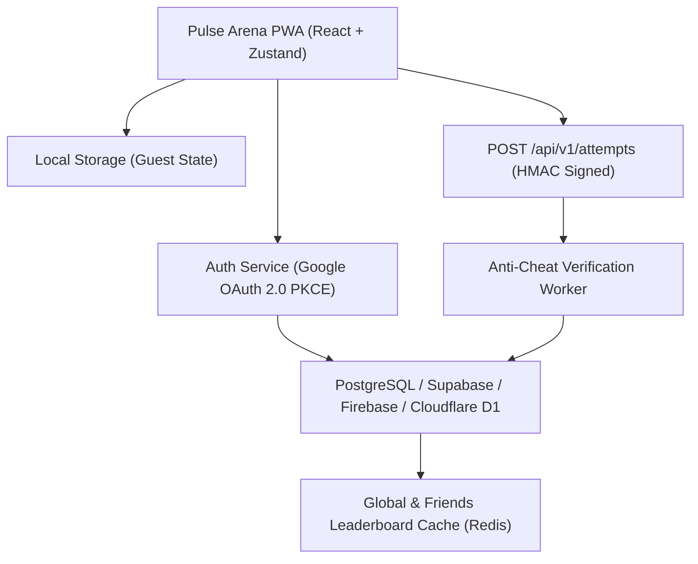

# Pulse Arena — Mobile-First Esports Training Platform

Pulse Arena is a high-performance progressive web app (PWA) built with **React 18 + TypeScript + Vite + Tailwind CSS** designed for competitive mobile esports athletes (mobile Battle Royale such as PUBG Mobile / BGMI / Free Fire, and mobile MOBA players like Mobile Legends: Bang Bang).

It delivers low-latency, abstract 1–2 minute drills focusing on **pure neural, visual, and motor mechanics**: reaction time, flick aim, continuous tracking, minimap awareness, ability cooldown memory, precision last-hit timing, split-attention decision making, working memory (N-back), and spatial audio localization.

---

## ⚡ Core Philosophy & Architecture

- **Abstract Athletic Conditioning**: Generic, original UI and abstract silhouettes (circles, diamonds, radar blips, cooldown arcs, minion health bars). No copyrighted game assets, audio, or maps.
- **Zero Input Latency**: Touch events utilize `touch-action: none` and `pointerdown` listeners with sub-millisecond timestamps captured using `performance.now()` in `useLayoutEffect` or high-rate requestAnimationFrame (rAF) loops.
- **Micro-Sized & Fully Offline (PWA)**: Completely procedural audio synthesized on the fly via the Web Audio API with zero audio asset downloads. Pre-cached service worker with manifest icons for homescreen installation.
- **Mobile-First Portrait UX**: Tailored for mid-range and flagship smartphones in vertical orientation with large hit targets ($\ge 48$px), safe-area insets (`env(safe-area-inset-top)` / `env(safe-area-inset-bottom)`), and tactile vibration haptics (`navigator.vibrate`).
- **Anti-Cheat Sanity Gates**: Real-time filtering of impossible physical reaction times ($< 80\text{--}100$ms), automated robotic detection (standard deviation $< 11$ms), sub-pixel unnatural tracking detection, and attempt rate-limiting.

---

## 🛠️ Tech Stack

- **Framework**: [React 18](https://react.dev/) + [TypeScript 5](https://www.typescriptlang.org/) + [Vite 6](https://vitejs.dev/)
- **Styling**: [Tailwind CSS 3](https://tailwindcss.com/) with high-contrast esports theme (`pulse`, `gold`, `iris`, `coral`, `lilac`)
- **Animations**: [Framer Motion](https://www.framer.com/motion/) with user motion preference gating (`reducedMotion="user"`)
- **State & Persistence**: [Zustand 5](https://zustand-demo.pmnd.rs/) with `persist` middleware (local-first guest mode with JSON export/import)
- **Routing**: [React Router 6](https://reactrouter.com/)
- **Game Engine**: Custom HTML5 Canvas 2D + DPR-scaling pipeline (`fitCanvas`) + pure React 60 FPS `requestAnimationFrame` loop
- **Audio & Haptics**: Native Web Audio API (`OscillatorNode`, `BiquadFilterNode`, `StereoPannerNode`) + HTML5 Vibration API
- **PWA**: `vite-plugin-pwa` with Workbox precaching and web app manifest

---

## 🎮 Playable Drill Modules

All drills follow a standard lifecycle: **Intro Panel & Difficulty Select $\rightarrow$ 3-2-1 Audio Countdown $\rightarrow$ Live Reps $\rightarrow$ Results & MMR Breakdown**.

| Drill | Category | Target Mechanics | Implementation Details |
|---|---|---|---|
| **Color Reaction** | Reflex & Aim | Go / No-Go reaction speed, inhibition control | `useLayoutEffect` timestamping. Green circle = tap ASAP; Gold diamond = inhibit. Sub-100ms flagged as early anticipation. |
| **Flick Aim** | Reflex & Aim | Snap target switching, flick accuracy | Canvas 2D rAF loop. Drifting neon targets with closing timeout arcs. Score blends reaction time ($72\%$) + distance to center core ($28\%$). |
| **Smooth Track** | Reflex & Aim | Continuous tracking, curve prediction | Harmonic sine wave trajectory. Measures frame-by-frame time-on-target uptime % and mean tracking error with pointer capture. |
| **Zone Recall** | Visual Search | 1-look minimap reading, cluster recognition | 3×3 tactical sector grid. Displays clustered enemy blips for 1.3s before fog-of-war. Player selects the highest-density sector. |
| **Cooldown Memory** | Memory & Focus | Ability tempo recall, timer tracking | 4 abstract abilities with circular timer arcs. Arcs drain then hide. Player recalls which ability reaches ready status first. |
| **Last Hit** | MOBA Mechanics | Health bar timing, execution windows | Creep health drains with variance. DOM manipulation bypasses React render overhead for butter-smooth 60fps needle movement into the gold execute bracket. |
| **Split Signal** | Decision & Focus | Dual-task multitasking, dual-thumb gating | Simultaneous left/right stimulus pads. Player processes both visual cues and commits or holds thumbs independently. |
| **Shape N-Back** | Memory & Focus | Working memory under sequence load | 2-back shape matching drill. Completely color-independent glyphs for deuteranopia / protanopia accessibility. |
| **Sound Ping** | Visual Search | Audio spatialization, ear localization | Web Audio `StereoPannerNode` generates bandpass-filtered noise bursts panned Left (-1.0), Center (0.0), or Right (+1.0). |

---

## 🏆 Scoring & Ranking System

Scores are normalized on a competitive **0–1000 scale**:
$$\text{Speed} = \operatorname{clamp}\left(\frac{\text{PoorMs} - \text{MedianRT}}{\text{PoorMs} - \text{ExcellentMs}}, 0, 1\right)$$
$$\text{Score} = 1000 \times \left(w_{\text{speed}} \times \text{Speed} + (1 - w_{\text{speed}}) \times \text{Accuracy}\right)$$

### 1. Dual Play Modes (Classic vs. Ranked)
Every drill module supports two distinct operational modes selected prior to arming the test:

- **Classic Mode (Unlimited Free Practice)**:
  - Play as many times as desired with zero daily restrictions.
  - Scores are **NOT** sent to the global database rankings.
  - Utilizes a specialized **5-Slot Scorecard**:
    - **Slot 1**: Always retains the **Highest Score** ever achieved by the player on that drill.
    - **Slots 2–5**: Stores the **latest 4 attempts** in reverse chronological order.
    - When a new score comes in, Slot 1 updates if the score is a new personal best, the new score is prepended to the latest list, and the oldest score is automatically evicted if the list exceeds 4 items.

- **Ranked Mode (Official Competitive Ladder)**:
  - Players receive strictly **2 Ranked attempts per day** for each drill.
  - Daily quota resets automatically at midnight based on local calendar date (`localDay()`).
  - Remaining daily attempts (`2/2`, `1/2`, `0/2 Locked`) are clearly displayed in the drill launcher, drill catalogue, and results panels.
  - Once 2 attempts are expended, Ranked Mode locks until the next calendar day.
  - **Only Ranked Mode results are committed to the Supabase cloud database (`test_results` where `mode = 'ranked'`)** for global leaderboard rankings.

### 2. Dedicated Rankings Page (`/ranking`)
- Dedicated ladder accessible from bottom navigation, Home quick-launch card, and test result screens.
- **Per-Drill Filtering**: Interactive category/drill switcher displaying separate standings for each drill.
- **Comprehensive Leaderboard Metrics**:
  - Global player position / rank (`#1`, `#2`, `#3`, ...)
  - Player callsign / username and avatar
  - Best Ranked Score on that drill (only each player's highest score is counted)
  - Speed / Reaction Time (ms) and Accuracy (%)
  - Timestamp of the achievement
- **Current Player Spotlight**: Highlights the authenticated player's standing with a distinctive gold border, `YOU` badge, and pinned rank summary bar.

### Rank Tiers
- **Apex Predator**: 950–1000 MMR (Electric Pulse)
- **Grandmaster**: 900–949 MMR (Coral Fire)
- **Master**: 800–899 MMR (Lilac Diamond)
- **Challenger**: 680–799 MMR (Iris Blue)
- **Vanguard**: 550–679 MMR (Gold)
- **Guardian**: 400–549 MMR (Silver)
- **Recruit**: 0–399 MMR (Bronze)

### Baseline Percentile Prior
For new installations where local historical samples are limited, Pulse Arena applies a Bayesian synthetic prior with Gaussian normal cumulative distribution:
$$\text{Percentile} = \frac{\text{LocalScoresBelow} + \operatorname{CDF}(\text{Score}, \mu_{\text{prior}}, \sigma_{\text{prior}}) \times N_{\text{prior}}}{N_{\text{local}} + N_{\text{prior}}}$$

---

## 🛡️ Anti-Cheat Sanity Gates

All submitted attempts pass through `flagAttempt()` (`src/lib/anticheat.ts`):
1. **Physical Reaction Floor**:
   Rejects reaction times physically impossible for human visual processing ($< 90\text{--}180$ms depending on the drill).
2. **Robotic Jitter Detection**:
   If sample size $\ge 5$ and standard deviation of reaction times $\sigma_{\text{RT}} < 11$ms, the attempt is flagged as an automated script or bot.
3. **Unnatural Track Lock**:
   In continuous tracking, an uptime $> 98\%$ with mean pixel error $< 2$px is flagged as programmatic tracking.
4. **Attempt Rate Limiting**:
   Attempts completed faster than 1.2s after the previous attempt are dropped.

*Flagged attempts are recorded for auditing but excluded from personal bests and leaderboard averages.*

---

## 🚀 Getting Started

### Prerequisites
- Node.js 18+ (tested on Node 20 / 22 / 24)
- npm or pnpm

### Installation & Development
```bash
# Clone the repository
git clone <repo-url>
cd Training

# Install dependencies
npm install

# Start local dev server
npm run dev

# Run TypeScript type check
npm run typecheck

# Build production bundle with PWA assets
npm run build

# Preview production build locally
npm run preview
```

---

## 🧩 How to Add a New Drill in 4 Steps

Pulse Arena uses a modular **Test Registry** design. Each test is a self-contained component that receives standard props (`mode`, `onComplete`, `onExit`).

### Step 1: Define Test Copy in `src/content/catalog.ts`
```typescript
{
  id: 'target-flicker',
  title: 'Target Flicker',
  category: 'awareness',
  duration: '45s',
  summary: 'Detect subtle luminance shifts across periphery.',
  goal: 'Train peripheral sensitivity and micro-saccades.',
  howTo: [
    'Observe the focal crosshair.',
    'Tap the quadrant that flickers.',
  ],
  tips: {
    solid: 'Keep gaze anchored on center crosshair.',
    slow: 'Rely on rod photoreceptors in peripheral vision.',
    shaky: 'Do not chase edges with your eyes.',
  },
  minReactionMs: 140,
  warmupOrder: 5, // optional for daily warmup sequence
}
```

### Step 2: Implement Drill Component in `src/tests/target-flicker/TargetFlicker.tsx`
```tsx
import { useState } from 'react'
import { DrillFrame } from '@/components/test/DrillFrame'
import type { TestModuleProps } from '@/types'

export default function TargetFlicker({ mode, onComplete, onExit }: TestModuleProps) {
  const [progress, setProgress] = useState('')

  return (
    <DrillFrame
      testId="target-flicker"
      mode={mode}
      onExit={onExit}
      progress={progress}
      onArmed={(difficulty) => {
        // Initialize trial loop or canvas loop
      }}
    >
      <div className="arena relative flex-1">
        {/* Drill UI / Canvas */}
      </div>
    </DrillFrame>
  )
}
```

### Step 3: Register in `src/types/index.ts`
Add `'target-flicker'` to `export type TestId = ...`.

### Step 4: Register Lazy Loader in `src/tests/registry.ts`
```typescript
const loaders: Record<TestId, LazyExoticComponent<ComponentType<TestModuleProps>>> = {
  // ... existing drills
  'target-flicker': lazy(() => import('@/tests/target-flicker/TargetFlicker')),
}
```
*The drill will automatically appear in catalog filters, category cards, daily warm-up playlists (if `warmupOrder` is set), and player stats!*

---

## ☁️ Future Backend & Cloud Architecture

Pulse Arena is designed to transition effortlessly from Guest Mode (`localStorage`) to a cloud-backed architecture without modifying any drill logic:



### Recommended Backend Stack
- **Authentication**: Supabase Auth or Firebase Auth with Google OAuth PKCE.
- **Database Schema**:
  ```sql
  CREATE TABLE users (
    id UUID PRIMARY KEY DEFAULT gen_random_uuid(),
    auth_id TEXT UNIQUE NOT NULL,
    display_name TEXT,
    avatar_url TEXT,
    created_at TIMESTAMPTZ DEFAULT NOW()
  );

  CREATE TABLE test_results (
    id UUID PRIMARY KEY DEFAULT gen_random_uuid(),
    user_id UUID REFERENCES users(id) ON DELETE CASCADE,
    test_id TEXT NOT NULL,
    score INTEGER NOT NULL CHECK (score >= 0 AND score <= 1000),
    reaction_time NUMERIC,
    accuracy NUMERIC NOT NULL,
    valid BOOLEAN NOT NULL DEFAULT true,
    flags TEXT[],
    metadata JSONB,
    created_at TIMESTAMPTZ DEFAULT NOW()
  );

  CREATE INDEX idx_user_test ON test_results (user_id, test_id, score DESC);
  ```
- **Sync Integration in `src/stores/progressStore.ts`**:
  Replace or supplement the `persist` storage handler with a debounced cloud sync hook that sends new attempts to `/api/v1/attempts`.

---

## 🗄️ Supabase Connection, Authentication & Admin Panel

Pulse Arena features a complete backend integration with Supabase for user signup, login, cloud score synchronization, and an esports coach Admin Command Center.

### 1. Step-by-Step Supabase Setup
1. Create a free project at [supabase.com](https://supabase.com).
2. In the Supabase Dashboard, go to **SQL Editor** -> **New Query**.
3. Copy and run the entire SQL migration script from `supabase/schema.sql`. This creates:
   - `profiles` table (tied to `auth.users` with `role: 'player' | 'admin'`)
   - `test_results` table with foreign keys, indexes, and anti-cheat audit flags
   - Automatic `handle_new_user()` trigger on signup
   - Row Level Security (RLS) policies
4. In your Supabase Project, go to **Project Settings** -> **API**.
5. Copy your **Project URL** and **anon / public key**, then create a `.env` file in the root directory:
   ```env
   VITE_SUPABASE_URL=https://your-project.supabase.co
   VITE_SUPABASE_ANON_KEY=eyJhbGciOiJIUzI1NiIsInR5cCI6IkpXVCJ9...
   ```
6. Restart your dev server: `npm run dev`.

### 2. Player Sign-up & Sign-in (`/auth`)
- Accessible from the Home header or Profile page.
- Supports email & password authentication with custom player callsign / display name.
- When an authenticated player completes any training rep, their verified result is automatically written to Supabase `test_results` table in the background.

### 3. Admin Command Center (`/admin`)
- Accessible to users with `role = 'admin'` (also appears on bottom navigation when logged in as admin).
- **KPI Metrics**: Total registered players, total platform runs, platform average MMR, total anti-cheat flags.
- **Roster Management**: Searchable directory of all players with email, callsign, join date, best scores, reaction times, and role badges.
- **Player Dossier Modal**: Click **Inspect** on any player to view their drill history and anti-cheat audit logs.
- **Role Promotion**: Directly promote or demote any player to/from the `admin` role from the interface.
- **Anti-Cheat Audit Feed**: Live log of runs flagged by anti-cheat filters.

### 4. How to Grant Admin Role in SQL
In your Supabase SQL Editor, run:
```sql
UPDATE public.profiles
SET role = 'admin'
WHERE email = 'your-email@example.com';
```
*(You can also use the built-in **"Preview Admin Mode"** button on `/auth` or `/admin` to test the command center right away without entering database credentials.)*

---

## 📜 Disclaimer

Pulse Arena is an independent training tool for reaction time, hand-eye coordination, and visual processing. It is not affiliated with, endorsed by, or associated with Krafton, Tencent, Moonton, Valve, Riot Games, or any other game publisher. Training drill scores do not guarantee in-game ranking.
